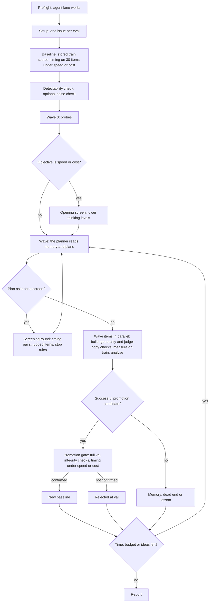

# How the loop works

This page explains the Kiln Harness Tuner for a reader who sees it for the first time.
It gives the whole path of a run, then one section for each objective. The
details, the constants and the reasons for each decision are in
[docs/architecture.md](architecture.md). The vocabulary is in
[docs/concepts.md](concepts.md).

## What the loop is

The loop automatically improves an AI agent by tuning its harness: the
prompt, model, tools, skills and settings around it. In Kiln, the agent is a
task, and its harness is the task's run config. You give the loop:

- a **baseline**: the task's current run config (a model, a prompt, tools,
  skills and model settings such as the thinking level);
- an **objective**: what "better" means;
- **limits**: money and time.

The loop then proposes changes, measures them and replaces the baseline only
when held-out data confirms that a change is better.

Agent sessions (`claude -p` by default) do the thinking and the building. Code
does all the measurement and makes every decision about a result. An agent
never reads a number that it could change, and it never decides a promotion
alone.

## The inputs

| Input | Flag | What it is |
|---|---|---|
| The task | `--project-id`, `--task-id`, `--project-path` | The Kiln task. Its default run config is the first baseline. |
| The objective | `--objective quality\|speed\|cost` | What the loop improves. One objective per run. The default is `quality`. |
| The model policy | `--model-policy PATH` | A JSON **file** of allowed and denied (provider, model) pairs, with `*` wildcards. Code applies it to every run config that an agent makes or drives. [examples/model-policy.json](../examples/model-policy.json) shows the shape. |
| The guidance | `--guidance TEXT` | Free text for the planner: what to try first, what not to try. |
| The limits | `--budget-usd`, `--timeout-mins` | The money and the time for the run. Code checks them at each wave boundary. |
| Parallelism | `--max-concurrent-evals`, `--max-concurrent-agents` | How many eval jobs and agent sessions run at the same time. |

The model policy keeps expensive models out. Every experiment reports its
latency and cost per request against its parent, read from the stored runs, at
no extra cost. Use `--objective speed` or `--objective cost` when latency or
cost is the goal.

## The data rule: train, val and test

The eval inputs of the task have three split tags.

| Split | Who reads it | What it is for |
|---|---|---|
| `train` | Agents, through the loop gateway, and the measurement code | All design, screening and experiment measurement. |
| `val` | Code at the promotion gate only | The confirmation of a winner before it becomes the baseline. |
| `test` | Nothing in the loop | Your own final check, after the run. |

The gateway refuses every agent request for an item that is not in train. So an
agent cannot design against the data that decides a promotion.

Agents read train traces as files. When an agent asks the gateway for train
results, the gateway writes each train trace to the run's scratch folder
(`~/.kiln_ai/harness_tuner/runs/<run id>/scratch/traces/` by default) and
answers with the file paths, a short summary per item, and a per-run-config
stats file (tool calls, tokens per turn, tool errors). The agent then uses
`Grep` and `Read` on the files. Only rows the gateway accepts as train are
written. No gateway answer is larger than a fixed cap; a longer answer comes in
parts.

## The path of a run

### 1. The start of a run

1. **Preflight.** Code makes sure that the agents can reach Kiln through the
   gateway.
2. **Setup.** Code makes one *issue* memory record for each eval. An issue is
   one thing that the task gets wrong. It is the target of quality work.
3. **The baseline.** Code reuses the baseline's stored train scores. Under
   `speed` and `cost` it also drives the baseline on 30 train items to get its
   latency and cost.
4. **The baseline audit.** Code searches the baseline's own prompt, skills and
   code tools for text copied from train items and for text copied from the
   judges, specs and eval descriptions. A finding becomes a scrub issue for the
   planner; it does not block builds.
5. **The detectability check.** Code calculates, from the stored scores, if the
   evals can show a significant win at all. A significant win needs at least 6
   items fixed in one direction. When the baseline fails only 2 items of an
   eval, that eval cannot show a quality win. Under `quality`, the check stops
   the run when no eval can show a win.
6. **The noise check** (`--noise-check N`, optional and paid). Code drives the
   baseline again on N train items for each eval and counts how often the same
   config gets a different result.
7. **Wave 0: probes.** Short yes/no questions about the baseline. For example:
   "Does the model call an attached tool under this output mode?" A probe drives
   about 3 items and reads the traces. It writes no experiment record.
8. **The opening screen** (`speed` and `cost` only). One screening round of the
   baseline's own model at every lower thinking level that the provider offers.

### 2. A wave

1. **Plan.** The planner agent reads memory: the issues, the earlier results,
   the dead ends, the lessons and the open questions. It returns a batch of
   work. It can ask for a screen or for probes first.
2. **Screen** (optional, at most 4 rounds in a wave). A screen is a cheap test
   of variants that need no build: a model, a provider, a thinking level,
   sampling settings or an output mode. Code puts all the candidates of the
   round through the same small train sample, in up to 3 chunks, and checks
   the stop rules after each chunk. The planner then gets a table of the
   survivors and plans again.
3. **The wave items**, in parallel. The main kind of item is the
   **experiment**:
   1. A build agent makes one new run config, for example a model swap, a
      prompt edit or a tool or skill change. It stamps the provenance and
      smoke-tests the config. It stops before any result exists.
   2. Two text checks run before any money is spent on measurement:
      - The **generality check** looks for text that copies train items, first
        in code (an exact-text search) and then in a review session.
      - The **judge-copy check** looks for a run of 8 or more words that the
        candidate's whole prompt, skills or code tools share with a judge
        prompt, an eval spec or an eval description. It reads the whole text,
        so a phrase inherited from a parent is caught too. Text that the
        baseline or the task instructions already have is allowed.

      A hit in either check gets one rebuild, with the findings. A second hit
      ends the item.
   3. **Measurement on train.** Code judges the config in chunks of 12 items,
      up to the whole train split, and checks the stop rules after each chunk.
   4. An analysis agent reads the numbers and says if the experiment met its
      goal. Code writes the verdict to memory.

   Other items are smaller: a probe, a measurement of an issue on the
   baseline, or a re-run of items with no stored result. An eval build for
   an issue that has no eval is experimental and off by default; only
   `--experimental-eval-building` turns it on. While it is off, code drops a
   planned eval build before its wave runs, and the report names the issue
   so that you can create its eval in the Kiln app.
4. **The promotion gate.** For each successful experiment that the planner
   marked as a promotion candidate:
   1. Code runs the candidate and the baseline on **every val item** of every
      active eval, with the same judge. Under `speed` and `cost` it also times
      them.
   2. Code applies the integrity checks. A prompt that copies judge text is
      refused (the build-time check should already have caught it). A large
      change in output length, changed output keys or a new kind of write
      action is flagged for the promotion agent. A refusal is printed in the
      log and written to the experiment's record, and its text-copy reason
      reaches the planner. The flags come from val traces, so they never reach
      the planner.
   3. The objective's rule decides (see the sections below). The winner becomes
      the new baseline. The other candidates are stamped `— REJECTED AT VAL`.
5. **The next wave** starts from the baseline, which can now be new.

### 3. How a measurement works

Every candidate goes through one measurement engine, in chunks.

- **Timing pairs.** Under `speed` and `cost`, in every screening round, and to
  check the lever of a model swap, each chunk first drives 15 train items
  without a judge, up to 30 in total. The candidate and the baseline run the
  same item one after the other, in the same time window. So provider load
  affects both sides of a pair in the same way. Under `quality` an experiment
  is not timed: its latency and cost per request are read from its stored runs
  and shown on its record.
- **Judged items.** Then one eval job for each eval judges the chunk's items.
  The baseline's judgments are its stored rows. Code compares the two on the
  same items.
- **Stop rules.** After each chunk, the first rule that fires stops the
  candidate. The rules depend on the objective. Each statistical rule uses a
  one-sided test. Its 5% error rate is split over the planned number of looks,
  so many looks do not make a false stop more probable. No rule fires before 6
  pairs or 6 judged items.

### 4. Memory

The loop keeps its state in Kiln memory records in the project: issues,
experiments, screen results, dead ends, lessons, blockers, open questions and
the baseline lineage. A new run's planner reads them, so it does not try a
known dead end again. A run does not resume in the middle. A restart repeats
the setup steps and the opening screen.

### 5. The end of a run

The run stops when:

- the time or the budget is used (near the limit, the last wave is a wrap-up
  wave);
- the planner says that nothing is left to try (`loop_exit`), or returns an
  empty plan;
- two waves in a row fail (the tripwire);
- an agent provider reports a quota or authentication error.

Then a report agent writes the round report from the run's records, and code
saves it to `~/.kiln_ai/harness_tuner/reports/kiln-harness-tuner-<run id>.md`
by default. The run prints the path when it ends. The state folder holds all
of a run's files
([install.md](install.md#where-the-tuner-keeps-its-files)).

## The objectives

### `--objective quality`

The goal is higher eval scores.

- **What the planner works on.** Issues: one failure class of one eval. A fix
  experiment targets one issue's eval. When an issue has no eval that can
  measure it, the planner leaves it, and the report names it so that you can
  create its eval in the Kiln app. With `--experimental-eval-building`
  (experimental, off by default), an eval-build item makes the eval first.
  The eval is frozen before the fix is built, so the fix cannot shape its
  own test.
- **Which train items are judged first.** The items that the baseline fails
  on the target evals (up to 8), then a few that it passes (up to 4) as
  guards, then the rest of the split. A fix must show on the failures first.
- **Stop rules on train:**
  - `eval_metric`: quality is clearly worse than the parent;
  - `futility`: the target eval cannot end better than the parent, even if
    every remaining item goes the candidate's way;
  - `residual`: after the first chunk, fewer than half of the parent's
    failures in it are fixed, or the guards (parent passes in the chunk) broke
    clearly more often than noise explains (a one-sided binomial test against
    the noise check's flip rate, or 10% when no check ran). One broken guard
    out of 4 does not stop a candidate;
  - `targets`: an item that the planner named still fails after the first
    chunk.
- **Promotion.** With one candidate, a code rule decides. No eval may go down
  beyond doubt (its interval wholly below zero). At least one target eval must
  go up beyond doubt (significant, or its interval wholly above zero). A small
  rise with an interval that crosses zero does not promote alone. With two or
  more candidates, a `promote_best` agent ranks them on the code's table.
- **The limit to know.** When the baseline already passes almost every train
  item, there is nothing to fix, and the detectability check says so before
  the run spends money.

### `--objective speed`

The goal is lower latency per request with quality held.

- **The metric.** The sum of the LLM call latencies of one task run. For a
  multi-turn item it is the sum over the conversation. The simulated user's
  calls are not in it.
- **The opening screen** tries every lower thinking level of the baseline's
  model before wave 1.
- **Which train items are judged first.** Items that the baseline passes,
  ordered by fragility: how often other run configs failed them in their
  stored train rows. Up to 24 of them come first. The baseline's failures come
  last, so a small screen does not judge them. The question under `speed` is
  "does the candidate keep what the baseline gets right?", and a candidate
  can only win or tie on an item that the baseline fails.
- **Stop rules on train:**
  - `latency_ratio`: clearly slower than the baseline (a one-sided sign test
    on the pairs);
  - `not_better`: at 30 pairs, not clearly faster than the baseline;
  - `guard_losses`: the loss rate on judged baseline passes is clearly above
    the noise rate. The noise rate is the measured flip rate of the noise
    check, or 10% when no check ran. Fixes of baseline failures are shown
    apart and do not offset losses.
- **A model or provider swap** must be judged on at least 24 baseline passes
  (at most 40) before it can survive a screen. With no loss, 24 passes rule
  out a loss rate above about 12%.
- **Promotion.** On val, both of these must hold:
  1. Clearly faster: more items faster than not (exact sign test, p < 0.05), a
     median ratio below 1, and no significant p90 regression.
  2. Quality equal or better: no eval score down significantly, pooled net
     items at 0 or more (weighted by eval priority), and no single eval down
     more than a small number of items.

  The fastest candidate that meets both wins.

### `--objective cost`

The goal is lower provider cost per request with quality held. It works the
same way as `speed`, with cost in place of latency.

- **The metric.** The task run's own `usage.cost`. A model that has no price
  in Kiln reports no cost, and the loop then counts its cost as $0. Before the
  run, make sure that every model the planner can try has a price.
- **Stop rules on train:** `cost_ratio` (clearly costlier than the baseline),
  `not_better` (not clearly cheaper at 30 pairs) and `guard_losses`, as under
  `speed`.
- **Promotion.** The same two conditions as `speed`, with "clearly cheaper"
  in place of "clearly faster". The cheapest candidate that meets both wins.
- **What to expect.** A lower thinking level is often faster but not
  significantly cheaper, so a cost run drops it. A cheaper model usually loses
  some quality. The levers that keep quality are fewer tokens: fewer turns, a
  smaller prompt and fewer attached tools and skills.

## What the loop does not do

- It does not read test.
- It does not change the evals of a run. With
  `--experimental-eval-building` (experimental, off by default), an
  eval-build item can make a new eval before any fix is built.
- It does not resume a stopped run.
- It cannot show a change smaller than the evals can measure. A split of a
  few hundred items or fewer cannot rule out a drop of a few points.

[docs/limitations.md](limitations.md) has the full list.
